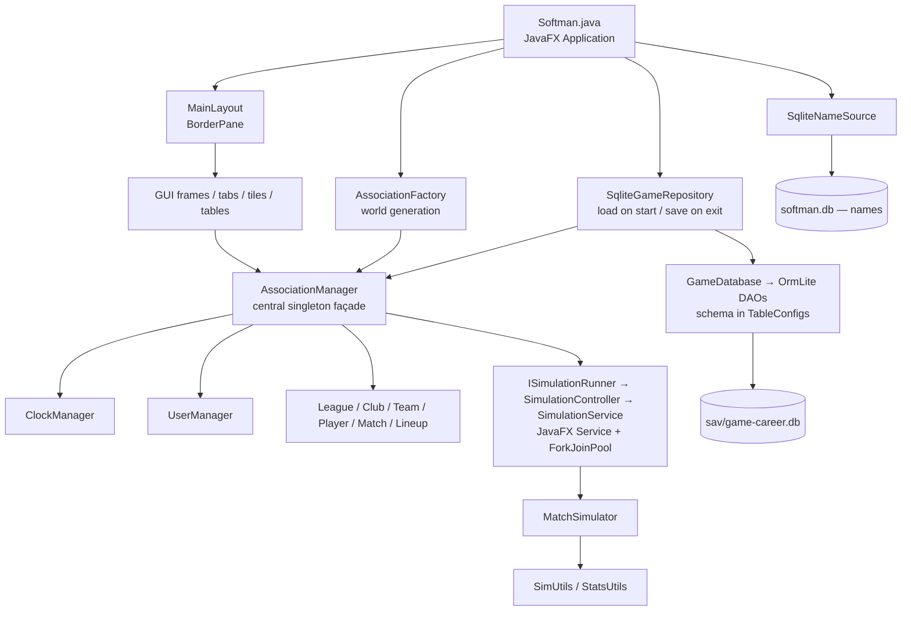

# ARCHITECTURE.md

<!-- ↓↓↓ agentcreed ↓↓↓ -->

This file describes project tech-stack, structure and coding conventions. Rules for handling this file are defined in [AGENTS.md](./AGENTS.md).

<!-- ↑↑↑ agentcreed ↑↑↑ -->

## Overview

SoftMan is a single-player desktop softball club/team management simulator. It is a Maven multi-module monolith:
a framework-free game core, an SQLite persistence adapter and a JavaFX client. Local desktop app only.

This file describes the current state. Pending work, known bugs and the backlog are in [.creed/SUGGESTIONS.md](./.creed/SUGGESTIONS.md).

## Tech Stack

| Category | Technology |
| --- | --- |
| Language | Java 27 (`maven.compiler.release` 27), OpenJDK; no `module-info.java`, JavaFX runs on the classpath |
| Build | Maven multi-module (`elrh:softman:1.0-SNAPSHOT`, packaging `pom`), compiler plugin 3.15.0 (Lombok annotation processor), surefire 3.5.4 |
| UI | JavaFX 27 (base/controls/graphics; programmatic, **no FXML**, built through `gui.kit`), AtlantaFX 2.1.0 (`NordLight` / `NordDark`, `Card`), Ikonli 12.4.0 + Feather pack, ControlsFX 11.2.4 (`GridView`) |
| Persistence | SQLite (`sqlite-jdbc` 3.51.1.0) via `ormlite-jdbc` 6.1 — snapshot save/load, not active record |
| Utilities | Lombok 1.18.48 (`LOG` field via `lombok.config`), commons-lang3 3.20.0 |
| Logging | SLF4J 2.0.17 API + `slf4j-simple` (see Repository Layout and Resources) |
| Testing | JUnit 6.0.2 (Jupiter), Hamcrest 3.0, TestFX 4.0.18 (`Headless` glass platform by default) |
| Run plugin | `javafx-maven-plugin` 0.0.8 — main class `elrh.softman.Softman`, extra `debug` execution (JDWP on `*:8000`, `suspend=y`) |
| CI / infra | None — no CI workflows, no containers |

## Architecture

Ports & adapters around the `AssociationManager` singleton façade. Dependencies point inward to `softman-core`;
the boundary is enforced by the module POMs (no JavaFX or JDBC dependency in core).

| Module | Packages | Allowed dependencies |
| --- | --- | --- |
| `softman-core` | `elrh.softman.logic`, `elrh.softman.utils` | commons-lang3, Lombok, SLF4J only — **no JavaFX, no JDBC** |
| `softman-db` | `elrh.softman.db` | core + sqlite-jdbc + ORMLite |
| `softman-desktop` | `elrh.softman` (main class `Softman`), `elrh.softman.gui.*` | core + db + JavaFX and UI libraries |

### Runtime wiring



### Package map

| Module | Package | Contents |
| --- | --- | --- |
| desktop | `.` | `Softman` — JavaFX `Application` entry point, game setup/teardown, theme switch |
| desktop | `gui` | `MainLayout` (BorderPane root) |
| desktop | `gui.frame` | `MenuFrame`, `FocusFrame`, `ContentFrame` (+ `Screen` enum for navigation), `ActionFrame` |
| desktop | `gui.kit` | `Cards`, `Tables`, `Ratings`, `Icons`, `Images`, `Layouts`, `Tokens` — the only sanctioned way to build UI |
| desktop | `gui.tab` | `ClubTab`, `MatchTab`, `TeamTab`, `PlayerTab`, `LineupTab`, `TrainingTab`, `StandingsTab` |
| desktop | `gui.tile` | `ClubInfoTile`, `CalendarTile`, `ScheduleRowTile`, `MatchHeaderTile`, `BoxScoreTile`, `LineupTile`, `LineupRowTile`, `DefenseTile`, `PlayerInfoTile`, `PlayerAttributesTile` |
| desktop | `gui.table` | `LeagueStadingsTable`, `TeamPlayersTable` |
| desktop | `gui.sim` | `SimulationController`, `SimulationService` |
| desktop | `gui.utils` | `FormatUtils`, `GUIUtils`, `InfoUtils`, `ProgressIndicatorUtil` |
| db | `db` | `GameDatabase` (connection + DAOs), `TableConfigs` (the whole schema), `SqliteGameRepository`, `SqliteNameSource`, `LocalDatePersister`, and the persistence-only rows `GameMeta`, `TeamPlayerRow`, `LineupSpotRow`, `BoxScoreRow` |
| core | `logic` | `AssociationManager`, `MatchSimulator`, `Result` (a `record`) |
| core | `logic.core` | `League`, `Club`, `Team`, `Player`, `Match`, `Lineup` |
| core | `logic.core.data` | `AbstractEntity` + plain data holders: `ClubInfo`, `LeagueInfo`, `TeamInfo`, `LineupInfo`, `MatchInfo`, `MatchPlayByPlay`, `PlayerInfo`, `PlayerAttributes`, `PlayerRecord`, `PlayerStats` |
| core | `logic.core.stats` | `Standing`, `BoxScore` |
| core | `logic.managers` | `ClockManager`, `UserManager` |
| core | `logic.enums` | `PlayerPosition`, `PlayerLevel`, `PlayerGender`, `MatchStatus`, `StatsType`, `ActivityType` |
| core | `logic.interfaces` | `IFocusedClubListener`, `IFocusedTeamListener`, `ISimulationRunner`, `IMatchReporter`, `IConfirmationPrompt`, `IGameRepository`, `INameSource`, `ISubstitutionStrategy` |
| core | `logic.strategy` | `RandomSubstitutionStrategy` |
| core | `utils` | `Constants`, `ErrorUtils`, `SimUtils`, `StatsUtils`, `Utils` |
| core | `utils.factory` | `AssociationFactory`, `ClubFactory`, `TeamFactory`, `PlayerFactory` |

### Cross-cutting patterns

- **Façade** — `AssociationManager` owns the world: clubs, leagues, teams, players, matches, the clock (`ClockManager`) and user focus (`UserManager`).
- **Singletons everywhere** — every manager, frame and tab exposes `getInstance()`. Tests bypass JavaFX through the `AssociationManager.testMode` flag.
- **`Result` record** — `(boolean ok, String message)` returned from most mutating operations instead of exceptions; `ErrorUtils.handleException()` converts throwables into it.
- **Domain / data split** — rich domain objects (`Player`, `Team`, …) wrap plain Lombok data holders in `logic.core.data` that extend `AbstractEntity` (only `getId()` + `equals`/`hashCode`).
- **Ports & adapters at the edges** — core defines the ports in `logic.interfaces`. `Softman.setupGame()` wires `SqliteGameRepository` (`IGameRepository`) and `SqliteNameSource` (`INameSource`); `Softman.setupStage()` wires `SimulationController` (`ISimulationRunner`) and `InfoUtils::confirm` (`IConfirmationPrompt`). `MatchTab.getMatchReporter()` supplies the `IMatchReporter`, `RandomSubstitutionStrategy` is the only `ISubstitutionStrategy`.
- **Snapshot persistence** — `SqliteGameRepository` saves/loads the whole world in one transaction, guarded by `GameMeta.SCHEMA_VERSION`; nothing touches the database during simulation.
- **Schema lives outside the domain** — OrmLite `DatabaseTableConfig`s are built by hand in `softman-db/TableConfigs`, so no persistence annotations leak into core.
- **UUID identity** — every entity is keyed by `UUID`; managers hold `LinkedHashMap<UUID, …>` to keep insertion order stable.
- **Observer** — `UserManager` broadcasts focused-club/focused-team changes to registered tabs (`IFocusedClubListener` / `IFocusedTeamListener`).
- **GUI kit** — screens are composed from `gui.kit` factories on AtlantaFX `NordLight`/`NordDark` (runtime toggle via Show → Dark theme); tab navigation goes through `ContentFrame.switchTo(Screen)`. Every tab sits in a fit-to-size `ScrollPane` (scrollbars only below the content's min size); `MainLayout` carries `sm-compact`, a tighter control density.
- **Two databases** — read-only `softman.db` (name pools, seeded from `names.sql`) and the save file `sav/game-<id>.db` — a single slot today, `sav/game-career.db`.

## Conventions

- **Language** — Java 27 source/target; modern features (records, sealed types, pattern matching) should be used.
- **Naming** — interfaces prefixed `I` (`IGameRepository`); GUI classes suffixed by role (`*Tab`, `*Tile`, `*Frame`, `*Table`); factories in `utils.factory`; utility classes `*Utils`.
- **Singletons** — managers, frames and tabs expose `getInstance()`; keep the pattern, no DI.
- **Errors** — mutating operations return `Result(ok, message)`; exceptions are converted via `ErrorUtils.handleException(source, ex)`, assertions via `ErrorUtils.raise(msg)`.
- **Lombok** — explicit imports only (never `import lombok.*`, it breaks javac 27 on `var`); log through `@Slf4j`'s `LOG`.
- **Core purity** — no JavaFX/JDBC in `softman-core`; persistence annotations never leak into domain classes (schema lives in `TableConfigs`).
- **GUI** — plain Java, no FXML; build via `gui.kit`; no hex colours outside the `.root` token block of `softman.css`; `sm-` prefixed style classes mirrored in `Tokens`; no pixel layout. Full rules: [.github/instructions/gui.instructions.md](./.github/instructions/gui.instructions.md) (history: [docs/archive/2026-javafx-gui-update.md](./docs/archive/2026-javafx-gui-update.md)).
- **Tests** — JUnit Jupiter + Hamcrest matchers; GUI covered only by a TestFX smoke test (see Tests).
- **Working directory** — run/test from repo root (surefire and javafx plugin set `workingDirectory` to `${project.basedir}/..`).
- No linters/formatters, git hooks, CI or containers are configured.

## Quick Commands

| Action | Command |
| --- | --- |
| Full build | `mvn clean install` |
| Fast compile check | `mvn -pl softman-desktop -am compile` |
| Test (headless) | `mvn -pl softman-desktop -am test` |
| Test (visible window) | `mvn -pl softman-desktop -am test "-Dtest.glass.platform=Win"` |
| Run | `mvn -pl softman-desktop -am javafx:run` |
| Debug (JDWP :8000, waits for the debugger) | `mvn -pl softman-desktop -am javafx:run@debug` |

On Windows PowerShell 5.1, redirect Maven output to a file (`*> out.txt`) instead of piping `2>&1`; JDK warnings on stderr otherwise surface as a failed command.

## Data Model

### Domain entities

All entities are identified by `UUID`.

- **Club** → owns many **Team**s (one per `PlayerLevel` + squad letter A/B/C), has money (`START_FUNDS = 100 000`), city, stadium, logo, and a colour stored as a hex string (`#ADD8E6`) rather than a JavaFX `Color`.
- **Team** → 20 generated **PlayerInfo**s + a `defaultLineup`; belongs to a `LeagueInfo`.
- **Player** → `PlayerInfo` (name, gender, birth year, jersey #, portrait) + `PlayerAttributes` + per-match `PlayerStats` list + `seasonTotal`.
- **League** → teams, matches, `Standing` list; knows `leagueAbove` / `leagueBelow` for promotion/relegation.
- **Match** → `MatchInfo` + away/home `Lineup` + `BoxScore` + `MatchPlayByPlay` list.
- **Lineup** → 10 batting spots (`ArrayList<PlayerRecord>` per spot to model substitutions) + 8 substitutes; supports DP.

### Player attributes (16, all `1..100`, randomly rolled)

`battingPower`, `swingControl`, `pitchEvaluation`, `pitchingSpeed`, `ballControl`, `pitchVariety`, `fieldingReach`, `gloveControl`, `throwControl`, `strength`, `speed`, `endurance`, `recovery`, `talent`, `dedication`, `luck`, plus mutable `fatigue` (0–100).

Derived: `battingSkill`, `pitchingSkill`, `fieldingSkill`, `physicalSkill`, `total`.

### Persisted tables (`TableConfigs.all()`)

`softman_club_info`, `softman_league_info`, `softman_team_info`, `softman_lineup_info`, `softman_match_info`,
`softman_match_pbp`, `softman_player_info`, `softman_player_attributes`, `softman_player_record`,
`softman_player_stats`, `softman_standing`, `softman_team_player`, `softman_lineup_spot`,
`softman_box_score`, `softman_game_meta`.

The last four have no domain counterpart — they are join/snapshot rows (`TeamPlayerRow`, `LineupSpotRow`, `BoxScoreRow`) plus save-file metadata (`GameMeta`: schema version, save date, clock dates, user focus).

## Game Flow

Entry points: `Softman` (JavaFX `Application`), `AssociationFactory.populateAssociation()` (world generation), `SqliteGameRepository` (save/load) with the schema in `TableConfigs`.

1. `Softman.setupGame()` → installs `SqliteNameSource` and `SqliteGameRepository`, then **loads `sav/game-career.db` if it exists**; only when there is no save file does it fall back to world generation.
2. `AssociationFactory.populateAssociation()` → registers 16 hardcoded clubs, creates **one** league ("1st League Men"), forms 8 teams (20 random players each), schedules the season, adds a spare CLUB01 "B" team, forces the user onto `CLUB01`.
3. `Softman.setupStage()` wires the simulation runner and confirmation prompt, runs `AssociationManager.nextDay()` once, then `MainLayout.setUp()` builds the UI.
4. User advances time with **Next day** / **Simulate until** in `ActionFrame` → `SimulationController` → `SimulationService` (JavaFX `Service` + `ForkJoinPool` parallel match simulation) → progress spinner.
5. Matches can also be played in `MatchTab` — *Play game* (one play per click), *Simulate inning*, *Simulate game* — with manual substitutions / position changes for the user's team. `ScheduleRowTile` rows offer simulate / play / view icon buttons.
6. `Softman.closeIfConfirmed()` (Esc key, or Game → Exit) → `saveGame("career")` writes the whole world in one transaction, then closes the stage.

### Season structure

- The clock starts on `Constants.START_DATE` (31 March); the season starts on the fixed `League.LEAGUE_START = LocalDate.of(START_YEAR, 4, 1)`, one round per week.
- `getTotalRounds() = (teams - 1) * 4` → **28 rounds** for 8 teams (quadruple round-robin), 4 matches per round.
- Standings points = `wins * 2 + loses` (participation point per loss); tiebreak: points → games → run diff → RF → RA.

### Match simulation model (`MatchSimulator` + `SimUtils`)

- Loop: pitch outcome → play outcome → total bases / fielding outcome, driven by `qualityFactor = (batterSkill + rnd100) - (pitcherSkill + rnd100)`.
- Outcome tiers: `O_K` strikeout / `O_W` walk-or-HBP / `O_P` ball in play; then `P_H` hit / `P_F` fielded; then out vs. error.
- Mercy rules implemented (15/10/7 run margins by inning, walk-off after 7). A walk-off ends on the deciding run: extra runs don't count, and the batter is credited with a single (deciding runner from 2nd/3rd) or at most a double (from 1st). Over-the-fence home runs count every run.
- Box score, hits, errors, and full batting/pitching/fielding stat lines are produced by `StatsUtils.saveStats()` into the in-memory model.
- Play-by-play is always collected into `Match.playByPlay`; `visualMode` only controls whether each line is also pushed to the `IMatchReporter` (the `MatchTab` text area).
- In-game substitutions: an `ISubstitutionStrategy` (currently `RandomSubstitutionStrategy`) decides for AI teams and for the user's team during auto-simulation; otherwise the user substitutes manually. Defense is re-settled automatically if a lineup becomes invalid.
- Fatigue increases per `ActivityType` after a match and recovers each new day.

## Feature Status

Known bugs in the features below are tracked in [.creed/SUGGESTIONS.md](./.creed/SUGGESTIONS.md).

### Implemented

- World generation: 16 clubs, teams, procedurally-named players with portraits.
- Single-league season scheduling (28 rounds, weekly).
- Full match simulation with play-by-play text, box score, mercy rules, substitutions, DP rule.
- Batting / pitching / fielding statistics tracking, AVG / SLG / ERA / IP / FLD computation, per-match + season totals.
- League standings with promotion/relegation ordering helpers.
- Player fatigue gain and daily recovery.
- Lineup editor with validation (no duplicate starters/positions), persisted per team.
- Defensive field visualisation, player rating bars, roster tables, daily calendar/schedule.
- Time control: next day, simulate-until-date, simulate single inning, day/round browsing, spinner + background simulation.
- **Save / load** — the entire world (clubs, leagues, teams, players, lineups, matches, box scores, play-by-play, standings, clock and user focus) round-trips through `SqliteGameRepository` in a single transaction. Auto-load on start, auto-save on exit, plus Game → Save game.
- GUI on AtlantaFX + Ikonli with a light/dark theme toggle.

### Partially implemented

| Feature | State |
| --- | --- |
| Multi-league / multi-tier pyramid | Fully coded in `AssociationFactory.createLeagues()` but **commented out** for start-up speed; only 1 league is live |
| Promotion / relegation | `getAdvancingTeams()` / `getRelegatedTeams()` / `recreateLeagues()` are reachable (the year rollover fires on any 1 January), but with a single league there is no `leagueAbove` / `leagueBelow`, so the transfer branches never execute |
| Multi-season progression | `recreateLeagues()` creates a fresh league and schedule each 1 January; rosters carry over unchanged, the new schedule reuses the fixed `LEAGUE_START` date, and the path has no test coverage |
| Save slots | One fixed slot, `Constants.DEFAULT_GAME_ID = "career"`; no file picker, no multiple saves |
| New game / Load game (menu) | Menu items exist, but both go through `AssociationManager.reset()`, which currently aborts |
| Career statistics | `PlayerTab` shows season totals; multi-season aggregation is a TODO |
| Standings UI | `StandingsTab` still contains MOCK "Play league" / "Play round" buttons wired to broken `League.mockPlay*()` methods |
| `MatchTab` refresh | Works, but refreshes the whole schedule after every play |
| About dialog | `MenuFrame` item exists with an empty handler |

### Not implemented

- **Training** — `TrainingTab` is a dummy 30-cell `GridView` with empty listeners; no training logic, no attribute progression.
- **Statistics centre** tab — a "coming soon" placeholder.
- **Transfer market** tab — a "coming soon" placeholder; no contracts, wages, scouting or trading despite `money` existing on clubs.
- **Club selection** — user is force-assigned `CLUB01`.
- **Player aging / development / retirement** — age is computed, but nothing changes attributes over time.
- **Finance model** — `START_FUNDS` is set and displayed, never spent or earned.
- **AI opponent management** — CPU teams never change lineups or rosters.
- **Playoffs / cups / international competition** — none.
- Fullscreen mode, custom window chrome, and exit confirmation are all commented out ("before going live").

## Tests

- `softman-core` — `AbstractEntityTest`, `AssociationManagerTest` (incl. the walk-off rule), `ClockManagerTest`, `ClubTest`, `LeagueTest`, `LineupTest` (incl. substitutions), `MatchTest`, `PlayerTest`, `TeamTest`, `UserManagerTest`, helper `TestUtils`. Pure in-memory; no test touches a database.
- `softman-desktop` — `GuiSmokeTest` (TestFX, `Headless` glass platform, `-Dtest.glass.platform=Win` shows the window): all tabs present and render, `switchTo` navigation, every tile constructs and loads, kit components, dark theme.
- `softman-db` — no test sources.

**Not covered:** the persistence layer including the save/load round-trip, `MatchSimulator` and the `SimUtils` probability model (only the walk-off rule is checked statistically), `StatsUtils` computations, GUI behaviour beyond smoke rendering, `SimulationService` concurrency, `AssociationFactory.recreateLeagues()`.

## Repository Layout and Resources

```text
SoftMan/
├── pom.xml                 # parent POM: modules, dependencyManagement, plugin config
├── lombok.config           # log field renamed to LOG
├── names.sql               # seed data for the softman.db name pool
├── softman.db              # read-only name-pool DB
├── softman-core/           # src/main (see Package map), src/test (pure in-memory JUnit, elrh.softman.test)
├── softman-db/             # src/main only, package elrh.softman.db
├── softman-desktop/        # src/main (Softman + gui.*, resources below), src/test (GuiSmokeTest)
├── docs/                   # archive/ (2026-javafx-gui-update.md, 2026-architecture-changes.md), screenshots/old
├── .github/instructions/   # gui.instructions.md (applies to softman-desktop/**)
├── .agents/skills/         # AgentCreed skills
├── .creed/                 # SUGGESTIONS.md — pending work, known bugs, backlog
├── sav/, log/              # runtime output, gitignored
└── */target/               # build output
```

| Path | Contents |
| --- | --- |
| `softman-desktop/src/main/resources/css/softman.css` | `sm-*` token layer over AtlantaFX NordLight/NordDark |
| `softman-desktop/src/main/resources/img/faces/` | AI-generated portraits (`m*` / `f*`) |
| `softman-desktop/src/main/resources/img/teams/` | club logos |
| `softman-desktop/src/main/resources/img/vecteezy/` | field, blank avatars |
| `softman-desktop/src/main/resources/img/` | `ball.png` (menu brand), `stadium.jpg` (CSS background) |
| `softman-desktop/src/main/resources/simplelogger.properties` | INFO level → `log/softman.log` (a test-scoped copy lives in `softman-core/src/test/resources`) |
| `names.sql` | first/last names seeding `softman.db` |
| `log/`, `sav/` | Runtime folders resolved against the repo root; `sav` is auto-created by `GameDatabase` |
